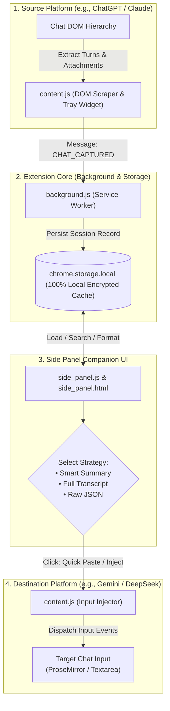

# PromptPort 🚢

<p align="center">
  
</p>

<p align="center">
  <strong>Port your prompts and conversation history to any AI in one click.</strong>
</p>

<p align="center">
  <em>Capture, condense, and transfer conversation context seamlessly across ChatGPT, Claude, Gemini, DeepSeek, Grok, Kimi, and Z-AI. 100% client-side. Zero cloud telemetry.</em>
</p>

<p align="center">
  <a href="#supported-platforms"></a>
  <a href="#installation"></a>
  <a href="#installation"></a>
  <a href="#privacy--security"></a>
  <a href="#privacy--security"></a>
  <a href="LICENSE"></a>
  <a href="CONTRIBUTING.md"></a>
</p>

---

## Table of Contents
- [Why PromptPort?](#why-promptport)
- [Key Features](#key-features)
- [Architecture & Data Flow](#architecture--data-flow)
- [Supported Platforms](#supported-platforms)
- [Installation](#installation)
  - [Method 1: Ready-to-Use ZIP Package (Recommended)](#method-1-ready-to-use-zip-package-easiest--fastest--no-git-needed)
  - [Method 2: Build from Source](#method-2-build-from-source)
- [User Guide & Workflows](#user-guide--workflows)
  - [1. Capturing Conversations](#1-capturing-conversations)
  - [2. Managing & Searching Sessions](#2-managing--searching-sessions)
  - [3. Choosing Context Transfer Strategies](#3-choosing-context-transfer-strategies)
  - [4. Porting & Quick Pasting into Another AI](#4-porting--quick-pasting-into-another-ai)
  - [5. Exporting & Backups (PDF, DOC, JSON)](#5-exporting--backups-pdf-doc-json)
- [Settings & Customization](#settings--customization)
- [Privacy & Security](#privacy--security)
- [Development & Building from Source](#development--building-from-source)
- [Troubleshooting & FAQ](#troubleshooting--faq)
- [Roadmap](#roadmap)
- [Contributing](#contributing)
- [License](#license)

---

## Why PromptPort?

Modern AI workflows rarely happen in a single model. You might begin an architecture discussion in **ChatGPT**, cross-validate code in **Claude**, generate multimodal charts in **Gemini**, and benchmark logic in **DeepSeek**.

However, switching platforms currently means **starting from scratch**:
- Copying and pasting messy, unformatted chat logs.
- Wasting tokens on conversational fluff ("Sure, I can help with that!").
- Losing uploaded file references and code block formatting.
- Exceeding destination context limits.

**PromptPort** solves this context fragmentation. It operates as an unobtrusive browser companion that extracts rich conversation turns, distills key goals and decisions, and ports clean context into whatever AI model you open next.

---

## Key Features

### ⚡ 1-Click Universal Context Capture
Capture conversation threads directly from web interfaces with one click. Use the persistent **Floating Action Button (FAB)** injected next to the chatbox or the **Side Panel header button**.

### 🔄 Direct Target AI Injection ("Quick Paste")
Never manually switch tabs to copy and paste again. Click **Quick Paste** or **Inject into Current Chat**, and PromptPort automatically focuses the target chat composer (ProseMirror, textarea, or rich editor) and dispatches native input events.

### 🧠 3 Intelligent Porting Strategies
Choose how your context is formatted before porting:
1. **Smart Condensed Summary**: Extracts the *Primary Goal*, *Key Decisions & Constraints*, and *Recent Turns*, drastically reducing token consumption.
2. **Full Conversation Transcript**: Clean user/assistant dialogue with preserved code formatting and language tags.
3. **Raw Data (JSON)**: Structured JSON payload ideal for programmatic analysis, custom LLM pipelines, or backup storage.

### 📊 Token Metrics & Cost/Compression Estimator
Live word and token counter calculates real-time token savings (e.g. `~1,250 words • ~1,680 tokens • -64% compressed`) so you stay well within rate limits and context budgets.

### 📎 Rich Attachment Extraction
Extracts uploaded files, documents (`.pdf`, `.py`, `.csv`, `.docx`, `.json`), document chips, and generated image attachments alongside message text.

### 🎨 Figma-Polished Companion UI
- Built to match Figma design tokens with pixel-perfect typography.
- Full support for **Light**, **Dark**, and **System** themes.
- Configurable floating button position (bottom-right vs. bottom-left).

### 💾 Multi-Format Export & Zero Cloud Dependency
- Export any thread directly to **PDF**, **DOC/DOCX**, or **JSON**.
- Complete full-database export and restore mechanism.
- **100% Private**: Runs entirely in your browser using `chrome.storage.local`. Zero third-party servers, zero telemetry.

---

## Architecture & Data Flow



---

## Supported Platforms

| AI Platform | Domain(s) | Chat Capture | Input Injection | Attachment Extraction | Code Blocks |
| :--- | :--- | :---: | :---: | :---: | :---: |
| **ChatGPT** | `chatgpt.com`, `chat.openai.com` | ✅ Full | ✅ Full | ✅ Full | ✅ Highlighted |
| **Anthropic Claude** | `claude.ai` | ✅ Full | ✅ Full | ✅ Full | ✅ Highlighted |
| **Google Gemini** | `gemini.google.com` | ✅ Full | ✅ Full | ✅ Full | ✅ Highlighted |
| **DeepSeek** | `chat.deepseek.com`, `deepseek.com` | ✅ Full | ✅ Full | ✅ Full | ✅ Highlighted |
| **Grok** | `grok.com`, `x.com`, `twitter.com` | ✅ Full | ✅ Full | ✅ Partial | ✅ Highlighted |
| **Kimi** | `kimi.ai`, `kimi.moonshot.cn` | ✅ Full | ✅ Full | ✅ Full | ✅ Highlighted |
| **Z-AI / ChatGLM** | `z.ai`, `chatglm.cn`, `bigmodel.cn` | ✅ Full | ✅ Full | ✅ Full | ✅ Highlighted |
| **InternLM** | `internlm.org` | ✅ Full | ✅ Full | ✅ Partial | ✅ Highlighted |
| **Generic AI Sites** | *Fallback Scraper* | ⚠️ Generic | ⚠️ Generic | ⚠️ Best-effort | ✅ Plain |

---

## Installation

### Method 1: Ready-to-Use ZIP Package (Easiest & Fastest — No Git Needed!)
You do **not** need to download the whole repository or install any developer tools:
1. Go to the [Releases](https://github.com/Kul-Utkarsh/promptport/releases) page.
2. Under **Assets**, download **`promptport-v1.0.0.zip`** (lightweight ~56 KB package containing strictly the files needed to run the extension).
3. Unzip the downloaded file to a folder on your computer.
4. Open Google Chrome (or Edge/Brave/Arc) and go to `chrome://extensions/`.
5. Toggle on **Developer mode** in the top-right corner.
6. Click **Load unpacked** (top-left) and select the unzipped folder.
7. Done! The PromptPort icon is now active in your toolbar.

### Method 2: Build from Source
If you are developing or contributing:
1. Clone this repository:
   ```bash
   git clone https://github.com/Kul-Utkarsh/promptport.git
   cd promptport
   ```
2. Build the extension package:
   ```bash
   npm run pack
   ```
3. Load either the `public/` folder or the generated `release/promptport-v1.0.0.zip` (unzipped) into `chrome://extensions/` via **Load unpacked**.

---

## User Guide & Workflows

### 1. Capturing Conversations
When navigating any supported AI platform (e.g. ChatGPT, Gemini):
- **Option A (Floating Widget)**: A discreet context pill appears near the chat input. Click **Capture Conversation** to immediately index the ongoing chat.
- **Option B (Side Panel Header)**: Click the PromptPort icon in your toolbar to open the Chrome Side Panel, then click **Capture**.

### 2. Managing & Searching Sessions
- Filter sessions using platform chips: `All`, `ChatGPT`, `Gemini`, `Claude`, `DeepSeek`, `Z-AI`.
- Search by keyword across conversation titles or message body contents.
- Star favorite discussions to keep critical context pinned.
- Rename conversations inline with the pencil icon.

### 3. Choosing Context Transfer Strategies
Open any session card to access the **Detail & Preview Screen**:
- **Smart Summary**: Automatically compresses lengthy threads into *Primary Goal*, *Key Decisions*, and *Recent Turns*.
- **Full Conversation**: Displays the complete turn history with formatted code blocks and individual code block copy buttons.
- **Raw JSON**: Outputs structured data for programmatic usage.
- **Turn Limiter**: Set the depth limiter (e.g., last 3 turns, last 5 turns, or full discussion).

### 4. Porting & Quick Pasting into Another AI
1. Navigate to your target AI tab (e.g. switch from ChatGPT to Claude).
2. In the Side Panel, locate the captured session.
3. Click **Quick Paste** on the card, or **Inject into Current Chat** from the detail preview.
4. The synthesized context is inserted directly into the destination prompt box ready for submission!

### 5. Exporting & Backups (PDF, DOC, JSON)
- Open the export dropdown menu in any session preview:
  - **Export as PDF**: Generates a clean printable document.
  - **Export as DOC**: Generates a rich Word-compatible document.
  - **Export as JSON**: Exports the individual thread in JSON format.
- In **Settings**, click **Export All Sessions (JSON)** to create a full portable backup, or **Import Backup** to restore your conversations on any machine.

---

## Settings & Customization

Click the gear icon (**Settings**) in the header to customize:
- **Theme**: Light, Dark, or System mode synchronization.
- **Default Strategy**: Set default formatting to *Smart Summary*, *Full Conversation*, or *Raw JSON*.
- **Floating Button (FAB)**: Toggle the floating widget on/off and choose placement (*Bottom-Right* or *Bottom-Left*).
- **Auto-Strip Noise**: Filter out common conversational pleasantries ("Hello! How can I assist you today?").

---

## Privacy & Security

PromptPort is designed from the ground up for strict privacy:

- **100% Client-Side**: No cloud servers, no proxy endpoints, no external database.
- **Zero Telemetry**: We do not collect analytics, telemetry, or user interaction tracking.
- **Local Storage Only**: All data is saved inside Chrome's sandboxed `chrome.storage.local`.
- **Zero Credential Exposure**: The extension operates strictly on rendered HTML. It never accesses authentication cookies, passwords, or API keys.
- **Strict Content Security Policy (CSP)**: Compliant with Manifest V3; disallows remote code execution and inline handlers.

For detailed security disclosures and permissions justifications, read [SECURITY.md](SECURITY.md).

---

## Development & Building from Source

The repository separates the development environment (`dev/`) from the sanitized release package (`public/`):

```bash
# 1. Clone the repository
git clone https://github.com/your-username/promptport.git
cd promptport

# 2. Run unit tests
npm test

# 3. Check JavaScript syntax
npm run check

# 4. Synchronize dev updates to public distribution
npm run sync:public
```

### NPM Scripts
- `npm test`: Runs automated unit tests (`dev/tests/core_seams.test.js`) against mock browser environments.
- `npm run check`: Performs syntax validation (`node -c`) on all JavaScript files.
- `npm run sync:public`: Validates code, runs tests, and copies runtime files from `dev/` to `public/`.
- `npm run test:public`: Verifies public distribution syntax integrity.

---

## Troubleshooting & FAQ

<details>
<summary><strong>Q: Why does the capture button report "0 messages found"?</strong></summary>
<p>
AI platforms frequently update their web DOM. Make sure the page has finished rendering messages. If a platform recently updated its layout, open an issue on GitHub and our community will update the scraper selector.
</p>
</details>

<details>
<summary><strong>Q: Does PromptPort work offline?</strong></summary>
<p>
Yes! The Side Panel, saved sessions, formatted summaries, and exports function 100% offline without requiring internet access.
</p>
</details>

<details>
<summary><strong>Q: Does PromptPort consume my API keys or tokens?</strong></summary>
<p>
No. PromptPort runs completely in your browser without requiring any OpenAI, Anthropic, or Google API keys.
</p>
</details>

<details>
<summary><strong>Q: Can I customize the prompt format used when pasting?</strong></summary>
<p>
Yes, you can choose between Smart Summary, Full Conversation, and Raw JSON, or adjust turn limits in the preview panel before injecting.
</p>
</details>

---

## Roadmap

- [x] Multi-platform DOM scrapers (ChatGPT, Gemini, Claude, DeepSeek, Grok, Kimi, Z-AI)
- [x] Chrome Side Panel Companion with Figma design tokens
- [x] Smart Context Condenser & Token Estimator
- [x] Cross-platform context injection & Quick Paste
- [x] Multi-format export (PDF, DOC, JSON backup)
- [ ] Support for Perplexity AI, Mistral Le Chat, and Poe
- [ ] Keyboard shortcut commands (`Alt+C` for quick capture, `Alt+V` for quick inject)
- [ ] Semantic search across historical conversations
- [ ] Firefox and Safari extension ports

---

## Contributing

We love contributions! Please check out [CONTRIBUTING.md](CONTRIBUTING.md) to learn how to add scrapers for new AI platforms, improve formatting, or submit bug fixes.

---

## License

This project is open-source and licensed under the **[MIT License](LICENSE)**.
